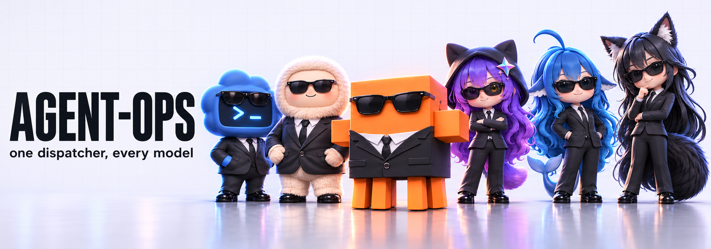

<a id="readme-top"></a>

<!-- PROJECT LOGO -->

<br />
<div align="center">
  <a href="https://github.com/AlaskanTuna/agent-ops">
    <picture>
      <source media="(prefers-color-scheme: dark)" srcset="/docs/readme/banner-dark.png">
      <source media="(prefers-color-scheme: light)" srcset="/docs/readme/banner-light.png">
      
    </picture>
  </a>

  <h3>agent-ops</h3>

  <p>
    One dispatcher, every model: route bulk work from any coding agent to the cheapest worker that can do it, fall back on its own, and keep the receipts.
    <br />
    <a href="#getting-started"><strong>Get Started &rarr;</strong></a>
    &middot;
    <a href="/docs/superpowers/specs/2026-11-15-fanout-ledger-design.md">Design</a>
    &middot;
    <a href="https://github.com/AlaskanTuna/agent-ops/issues/new?labels=needs-triage">Report a Bug</a>
    <br />
  </p>

[![Bun][bun-badge]][bun-url]
[![TypeScript][typescript-badge]][typescript-url]
[![DuckDB][duckdb-badge]][duckdb-url]
[![systemd][systemd-badge]][systemd-url]
[![Claude Code][claude-badge]][claude-url]
[![License][license-badge]][license-url]

</div>

<!-- TABLE OF CONTENTS -->

## Table of Contents

<details>
  <summary>Expand</summary>
  <ol>
    <li>
      <a href="#about-the-project">About The Project</a>
      <ul>
        <li><a href="#how-it-works">How It Works</a></li>
        <li><a href="#features">Features</a></li>
        <li><a href="#supported-workers">Supported Workers</a></li>
        <li><a href="#tech-stack">Tech Stack</a></li>
      </ul>
    </li>
    <li>
      <a href="#getting-started">Getting Started</a>
      <ul>
        <li><a href="#prerequisites">Prerequisites</a></li>
        <li><a href="#installation">Installation</a></li>
        <li><a href="#usage">Usage</a></li>
      </ul>
    </li>
    <li><a href="#license">License</a></li>
    <li><a href="#acknowledgments">Acknowledgments</a></li>
  </ol>
</details>

<!-- ABOUT THE PROJECT -->

## About The Project

A lead coding agent is expensive and its quota runs out. Most of what it grinds through is mechanical: reformat these twelve files, rename this across the repo, summarise each module. Cheaper models do that work well, but every worker CLI has its own flags, its own quota wall and its own error text, and an agent that hits a wall just stops.

agent-ops is a local operations platform for every agent harness on one machine: Claude Code, Codex, Gemini CLI, Antigravity and Copilot. Its first module, **fanout**, is one CLI that any of them can call. It picks the cheapest capable worker for a chunk, runs it in an isolated worktree, falls back to the next model when a quota, rate limit or credit runs out, and records every job in an append-only ledger. The lead agent keeps the judgement; the workers do the bulk.

The rule it never breaks: **every fallback is reported to the user, and every job on paid credit gets a cost estimate before it runs and the actual cost after.**

<p align="right"><a href="#readme-top">&uarr;</a></p>

### How It Works

<picture>
  <source media="(prefers-color-scheme: dark)" srcset="/docs/readme/architecture-dark.svg">
  <source media="(prefers-color-scheme: light)" srcset="/docs/readme/architecture-light.svg">
  
</picture>

The diagram is drawn with [Archify](https://github.com/tt-a1i/archify) from [architecture.json](/docs/readme/architecture.json).

1. **Pick.** Candidates are ranked by tier, then billing (subscription and free before paid), then estimated cost, then benchmark score. After 20 judged jobs for a model and task kind, your own success rate outranks the benchmarks.
1. **Run.** Each attempt gets a fresh git worktree. A private repository never goes to a model that trains on its input.
1. **Fall back.** A limit puts the model or account in cooldown, with a backoff that doubles from 15 minutes to 4 hours, and the chunk moves on. A rejected result climbs one rung: effort first, then tier.
1. **Report.** The result block, a Claude Code Stop hook and a desktop toast all make sure the user hears about every fallback and every paid job.
1. **Maintain itself.** A daily systemd timer discovers new and retired models, refreshes Artificial Analysis benchmarks, smoke-tests new models and learns new error patterns from real failures.

<p align="right"><a href="#readme-top">&uarr;</a></p>

### Features

- **One command from any harness.** `fanout run` works the same from Claude Code, Codex, Gemini CLI, Antigravity or Copilot; a shared skill teaches each of them.
- **Automatic fallback across harnesses**, with every hop reported and acknowledged.
- **Cost before and after** for USD credit (Meta, River, OpenRouter) and per-call billing (ModelScope Magicubes).
- **Fail open.** A broken ledger, DuckDB or upkeep never blocks a worker.
- **Private by default.** A repository with a private remote, or no remote, is private, checked anonymously so your own login cannot make it look public.
- **Append-only, schema-versioned JSONL ledger**, with `fanout report` analytics through DuckDB.
- **Self-maintaining catalog.** Three layers: public defaults in the repo, auto-discovered rows, and your private overrides in `~/.config/agent-ops/catalog.csv`.

<p align="right"><a href="#readme-top">&uarr;</a></p>

### Supported Workers

| Harness           | Worker CLI                      | Billing                  |
| ----------------- | ------------------------------- | ------------------------ |
| codex             | `codex exec`                    | ChatGPT subscription     |
| agy               | Antigravity `agy -p`            | Google subscription      |
| meta              | `claude -p` on Meta Model API   | USD credit               |
| river             | `claude -p` through CLIProxyAPI | USD credit               |
| openrouter-fanout | `claude -p` through CLIProxyAPI | OpenRouter USD credit    |
| modelscope        | `claude -p` through CLIProxyAPI | Magicubes per call       |
| opencode          | `opencode run`                  | Free Zen and opencode-go |

<p align="right"><a href="#readme-top">&uarr;</a></p>

### Tech Stack

- [Bun](https://bun.sh/) and TypeScript, zero runtime dependencies, installed as a single-file build
- [DuckDB](https://duckdb.org/) for analytics over the JSONL ledger
- systemd user units for daily upkeep
- Claude Code hooks for the report check

<p align="right"><a href="#readme-top">&uarr;</a></p>

<!-- GETTING STARTED -->

## Getting Started

### Prerequisites

- Linux or WSL2 with a systemd user session
- [Bun](https://bun.sh/) 1.4 or later
- [DuckDB](https://duckdb.org/) CLI 2.0 or later, for `fanout report`
- At least one worker CLI logged in: `codex`, `agy`, `claude`, `opencode`, or a [CLIProxyAPI](https://github.com/router-for-me/CLIProxyAPI) setup for the proxied harnesses

<p align="right"><a href="#readme-top">&uarr;</a></p>

### Installation

1. Clone the repository and install its development tools.

   ```sh
   git clone https://github.com/AlaskanTuna/agent-ops.git
   cd agent-ops
   bun install
   ```

1. Build a copy and install it. The installer links `fanout` onto `PATH`, adds the skill to each harness, and enables the daily upkeep timer. It backs up every file it edits.

   ```sh
   bash fanout/install/build.sh
   bash ~/.local/lib/agent-ops/fanout/<build-id>/install.sh
   ```

1. Check the install.

   ```sh
   fanout doctor
   bash ~/.local/lib/agent-ops/fanout/current/verify.sh --live
   ```

1. Optional: add a free [Artificial Analysis](https://artificialanalysis.ai/data-api) key so upkeep refreshes benchmarks daily.

   ```sh
   read -rsp "AA key: " k && echo "export AA_API_KEY=$k" >> ~/.config/tolong/secrets.env && unset k
   ```

<p align="right"><a href="#readme-top">&uarr;</a></p>

### Usage

In any harness, ask the agent to fan the work out, for example "fanout this: convert each file in `docs/old/` to the template in `docs/TEMPLATE.md`". The agent picks the model, asks you once, runs the workers and reports back.

From a shell:

```sh
fanout pick --brief brief.md --dir . --kind edit          # the ranked chain and any cost estimate
fanout run  --brief brief.md --dir . --kind edit          # run one chunk
fanout run  --brief brief.md --dir . --kind edit --detach # long jobs; then: fanout wait <job>
fanout status                                             # cooldowns, new models, anything unreported
fanout report --since 30d                                 # success rate and cost per model
```

Task kinds: `transcribe`, `reformat`, `rename`, `summarize`, `extract`, `inventory` start at tier 1; `edit`, `refactor`, `test`, `issue` start at tier 2. See [fanout/README.md](/fanout/README.md) for the data layout, catalog layers and how to add an adapter.

<p align="right"><a href="#readme-top">&uarr;</a></p>

<!-- LICENSE -->

## License

Distributed under the Apache License 2.0. See [LICENSE](/LICENSE) for more information.

<p align="right"><a href="#readme-top">&uarr;</a></p>

<!-- ACKNOWLEDGMENTS -->

## Acknowledgments

- Benchmark data: [Artificial Analysis](https://artificialanalysis.ai/), required attribution for use of their free API; [Arena](https://arena.ai/) WebDev and FrontierCode 2.0 scores imported by hand
- The agent setup of [m1kulabs](https://github.com/m1kulabs) projects, which this repository follows
- [Matt Pocock's skills](https://github.com/mattpocock/skills) and [Shields.io](https://shields.io)
- The banner is a fan rendition of model mascots (Clawd, Codex, Muse, Gemini, DeepSeek and GLM) in agent suits. agent-ops is not affiliated with or endorsed by any model provider

<p align="right"><a href="#readme-top">&uarr;</a></p>

<!-- MARKDOWN LINKS & IMAGES -->

[bun-badge]: https://img.shields.io/badge/Bun-000000?style=for-the-badge&logo=bun&logoColor=white
[bun-url]: https://bun.sh/
[typescript-badge]: https://img.shields.io/badge/TypeScript-3178C6?style=for-the-badge&logo=typescript&logoColor=white
[typescript-url]: https://www.typescriptlang.org/
[duckdb-badge]: https://img.shields.io/badge/DuckDB-FFF000?style=for-the-badge&logo=duckdb&logoColor=black
[duckdb-url]: https://duckdb.org/
[systemd-badge]: https://img.shields.io/badge/systemd-201A26?style=for-the-badge&logo=linux&logoColor=white
[systemd-url]: https://systemd.io/
[claude-badge]: https://img.shields.io/badge/Claude_Code-D97757?style=for-the-badge&logo=claude&logoColor=white
[claude-url]: https://docs.anthropic.com/en/docs/claude-code
[license-badge]: https://img.shields.io/badge/License-Apache_2.0-blue?style=for-the-badge
[license-url]: /LICENSE
